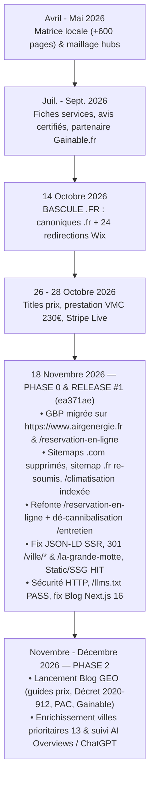

# Suivi SEO & GEO Airgenergie — Audit, Migration & Journal d'Actions

**Dernière mise à jour :** 18 Novembre 2026  
**Domaine cible canonique :** `https://www.airgenergie.fr` *(fusion `.com → .fr` finalisée)*  
**Statut global :** ✅ **Release SEO/GEO #1 (`ea371ae`) déployée & validée en production — Phase 2 (Blog GEO & Autorité IA) lancée**

---

## 1. Synthèse Exécutive (Point au 18 Novembre 2026)

Entre mi-octobre et mi-novembre 2026, le site a basculé de `airgenergie.com` vers `airgenergie.fr`, puis reçu le **18 novembre 2026** une refonte SEO/GEO chirurgicale (**Release #1 `ea371ae`**) visant deux priorités stratégiques :
1. **Faire décoller la page `/reservation-en-ligne`** (forfaits entretien climatisation, gainable, PAC & VMC dès 156 € TTC).
2. **Maximiser les citations d'Air G Énergie par les moteurs IA** (ChatGPT Search, Perplexity, Google AI Overviews, Google AI Mode, Gemini, Claude).

### Indicateurs clés Google Search Console (Relevé au 15–16 nov. 2026)
- **Impressions Novembre 2026 (15 jours consolidés) :** **5 356 impressions** et **50 clics** sur `.fr` *(dépassant déjà tout octobre en mi-mois ; projection ~10 700 impr / ~100 clics sur le mois)*.
- **Extinction du `.com` :** chute de **3 315 impr** (août) → **1 917** (oct.) → **326 impr / 2 clics** sur la première quinzaine de novembre (-83 %). Anciens sitemaps `.com` supprimés dans GSC le 18/11/2026.
- **Mobile vs Desktop (28 j : 19 oct → 16 nov, 8 900 impr / 79 clics) :**
  - **Mobile :** 3 076 impr | **55 clics (69,6 %)** | CTR **1,79 %** | Position **8,46 (1re page)**
  - **Desktop :** 5 679 impr | 22 clics | CTR 0,39 % | Position **22,87**
  - **Tablette :** 145 impr | 2 clics | CTR 1,38 % | Position **6,19**
- **Baseline `/reservation-en-ligne` (avant Release #1 — 28 j) :**
  - Page mère `/reservation-en-ligne` : **27 impressions, 0 clic, pos. 31,6** *(freinée par clone `/entretien`, H1 sans mot-clé, JSON-LD cassé et GBP sur `/book-online`)*.
  - Ensemble des 12 sous-pages `/reservation-en-ligne/*` : **306 impressions, 2 clics** (`/preventive` CTR 10 %, `/reprogrammation-thermostat` CTR 8,33 %).

---

## 2. Chronologie des Actions Techniques

---

## 3. Journal de la Release #1 (`ea371ae` — 18 Novembre 2026)

### A. Actions Phase 0 (Hors-code — Google Business Profile & Search Console)
- ✅ **Google Business Profile :** URL mise à jour vers `https://www.airgenergie.fr/` et réservation directe (fin des URLs `http://...wix_google_business_profile` et `/book-online?rwg_token=`).
- ✅ **Google Search Console (`sc-domain:airgenergie.com`) :** suppression des 2 anciens sitemaps `.com` via API GSC.
- ✅ **Google Search Console (`sc-domain:airgenergie.fr`) :** re-soumission du nouveau `sitemap.xml` (660 URLs propres, `lastmod` stable `2026-11-18`) + demande d'indexation manuelle sur `/climatisation` *(était inconnue de Google)*, `/reservation-en-ligne`, `/entretien` et `/`.

### B. Résultats Techniques Vérifiés en Production (Avant vs Après)

| Indicateur Live (`www.airgenergie.fr`) | Avant (18/11 matin) | Après `ea371ae` (18/11) | Gain |
| :--- | :--- | :--- | :---: |
| **TTFB & Cache `/`** | 245 ms (`MISS / no-store`) | **56 ms (`HIT`)** | **×4,4** |
| **TTFB & Cache `/reservation-en-ligne`** | 175 ms (`MISS / no-store`) | **75 ms (`HIT`)** | **×2,3** |
| **TTFB & Cache `/entretien`** | 178 ms (`MISS / no-store`) | **51 ms (`HIT`)** | **×3,5** |
| **JSON-LD `/reservation-en-ligne` & `/entretien`** | Cassé (`<meta application/ld+json>`) | **Valide SSR (`HVACBusiness` + `Service`/`OfferCatalog`/`ReserveAction` + `BreadcrumbList` + `FAQPage`)** | ✅ |
| **Contenu `/reservation-en-ligne` (SSR sans JS)** | 1 860 mots, H1 sans mot-clé, 0 FAQ visible, bugs VMC/VRV | **2 833 mots**, H1 géo+prix, tableau TTC HTML, 16 liens villes 13, marques, 7 FAQ visibles | ✅ |
| **Duplication `/entretien` vs `/reservation-en-ligne`** | Clone 95 % (même wizard & 14 cartes) | **0 % doublon** : `/entretien` = guide pilier Décret 2020-912 & contrats pros → CTAs vers `/reservation-en-ligne` | ✅ |
| **14 fiches `/reservation-en-ligne/[service]`** | Schema `Product` (5 warnings GSC) | **Schema `Service` + `Offer` + `BreadcrumbList` (SSG `PRERENDER`)** | ✅ |
| **Routes legacy `/ville/*` & hors-zone `/la-grande-motte`** | HTTP 200 (duplicate & hors 13) | **Redirections permanentes `308`** (`/*` et `/zones-intervention`) | ✅ |
| **En-têtes Sécurité HTTP** | HSTS seul | **HSTS preload + `X-Frame-Options` + `nosniff` + `Referrer-Policy` + `Permissions-Policy`** | ✅ |
| **Accessibilité Bots IA (`agentic_check.py`)** | `llms-txt` 404, groupes IA absents | **6/6 PASS** (`robots-ai-groups`, `waf-ua-matrix` 8/8 bots HTTP 200, `/llms.txt` Lighthouse `pass`) | ✅ |
| **Mentions « 2025 » & Entité** | 17 mentions 2025, 4 variantes nom, 2 adresses, EI vs SARL | **0 mention 2025**, entité unifiée **Air G Énergie SARL** (SIREN `909 266 256`, 3 rue du Pourra, Miramas) | ✅ |

---

## 4. Données Chiffrées Google Search Console (Historique Mensuel)

### Évolution Mensuelle `.fr` vs `.com`

| Mois | `.fr` Jours | `.fr` Impr. | `.fr` Clics | `.fr` CTR | `.fr` Pos. Moy. | `.com` Impr. | `.com` Clics |
| :--- | :---: | :---: | :---: | :---: | :---: | :---: | :---: |
| **Mai 2026** | 31 j | 5 003 | 63 | 1,26 % | 9,14 | 1 275 | 9 |
| **Juin 2026** | 30 j | 5 433 | 85 | 1,56 % | 7,79 | 2 412 | 22 |
| **Juillet 2026** | 31 j | 4 778 | 72 | 1,51 % | 8,09 | 2 160 | 13 |
| **Août 2026** | 31 j | 4 361 | 78 | 1,79 % | 9,07 | 3 315 | 21 |
| **Septembre 2026** | 30 j | 3 322 | 63 | 1,90 % | 7,23 | 2 495 | 20 |
| **Octobre 2026** *(bascule le 14)* | 31 j | 5 327 | 67 | 1,26 % | 14,29 | 1 917 | 9 |
| **Novembre 2026** *(1→15 nov)* | **15 j** | **5 356** | **50** | **0,93 %** | **17,39** | **326** | **2** |

---

## 5. Phase 2 en Cours & Prochains Jalons de Contrôle

### Chantiers Phase 2 (Novembre – Décembre 2026)
- [ ] **Pôle Blog GEO (`/blog`) :** publication des guides de référence (grilles tarifaires 2026 dans le 13, Décret n° 2020-912 & Cerfa, Préventif 156 € vs Curatif vapeur 100°C 192 €, Entretien Gainable Airzone, Entretien PAC Air/Eau 270 €, VMC 230 €) avec réponses citables 50 mots, tableaux HTML, sources officielles et maillage fort vers `/reservation-en-ligne`.
- [ ] **Affinage Phase 2 (prochain déploiement groupé) :** H1 de `/[ville]/entretien` (*« Entretien Climatisation & PAC à {Ville} »* au lieu de « CVC »), H1 de `/contact`, `/zones-intervention`, `/blog`, titres courts dans `cities.ts`, et enrichissement des 25–30 villes prioritaires du 13.
- [ ] **Hors-site Citations IA (Phase 3) :** vidéos courtes YouTube chantiers 13, routine avis Google mentionnant *prestation + ville*, posts LinkedIn B2B VRV/DRV, vérification domaine `airgenergie.fr` dans Resend.

### Jalons de Mesure KPIs
- **J+14 (2 Décembre 2026) :** vérifier l'indexation de `/climatisation`, la disparition des warnings `Merchant/Product`, la baisse des 93 URLs `/book-online?rwg_token=`, et la montée des impressions de `/reservation-en-ligne`.
- **J+30 (18 Décembre 2026) :** bilan complet clics/positions `/reservation-en-ligne` + rapport GSC *Performances IA générative* + tests de citation sur ChatGPT Search, Perplexity et Gemini.
